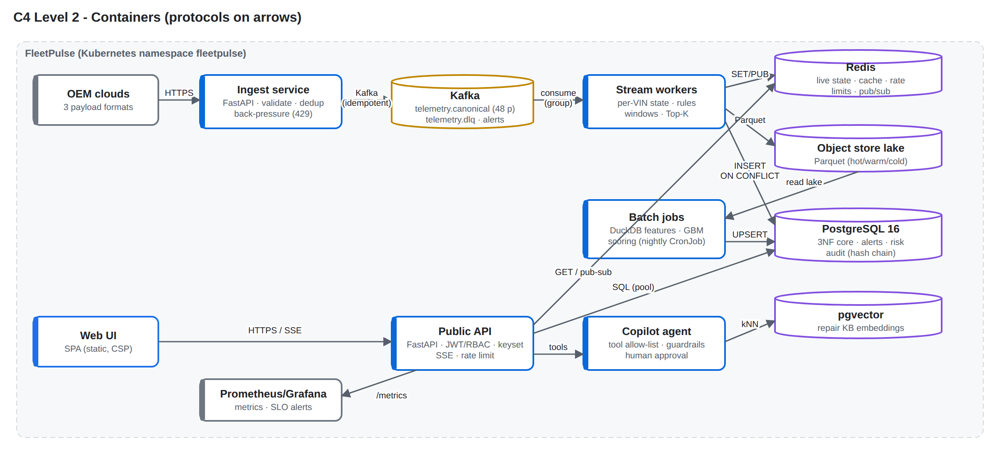

# FleetPulse – predictive maintenance for connected fleets

FleetPulse predicts which vehicles are likely to **break down in the next 7 days**, explains why, plans the workshop
week within technician capacity, and raises real-time alerts from a multi-OEM telemetry stream of **100,000 simulated
vehicles**. Built for the *Connected Vehicle Intelligence Hackathon* (Motorq used only as an industry reference).



## Headline results (measured; details in `docs/` and `bench/results/`)

| | Result |
|---|---|
| Model (temporal hold-out, 1.5M vehicle-days) | PR-AUC **0.53** vs 0.28 static thresholds and 0.12 severe-DTC rule; precision at a 1 %/day budget **0.57** vs 0.41 / 0.23 |
| Breakdown events caught (≥ 1 day ahead, 1 % flag budget) | **87 %**, median lead time 7 days |
| Ingest / stream throughput per core | 35K / 65K events/s; ingest scales ~linearly (30K → 65K ev/s from 1 to 2 processes) |
| End-to-end on 2 vCPU (Redis Streams bus) | 8K ev/s sustained + 24K ev/s bursts, **0 lost**, event→alert p95 **0.99 s** |
| Chaos: kill -9 a stream worker mid-run | 278,061 accepted = 278,061 stored, 0 lost, 0 duplicated, lag recovered within 1 s of restart |
| API (16 concurrent clients, same 2-vCPU host) | 329 rps, p95 **124 ms**, p99 196 ms |
| SQL | 53x / 371x / 12,000x faster on the three slowest queries |
| Tests | 91 pytest (unit + integration on real PostgreSQL/Redis) + 6 BDD scenarios; **95 %** line+branch coverage of core modules |

## Quick start

```bash
cp .env.example .env
# Fill the blank values in .env with unique local secrets before starting the stack.
docker compose up --build            # Kafka, PostgreSQL, Redis, seed job (100K vehicles x 90 days), api, ingest, 2 workers, simulator, Prometheus, Grafana
open http://localhost:8000           # dashboard; sign in with an account provisioned in the database
open http://localhost:8000/ops       # pipeline operations view
open http://localhost:8000/docs      # OpenAPI
```

Without Docker (what the benchmarks used): PostgreSQL 16 + Redis 7 running locally, then

```bash
pip install -r requirements-dev.txt
make seed        # dataset (21 s) -> model (~2 min) -> Postgres load + scoring (~75 s)
make run         # api + 2 stream workers + simulator on Redis Streams
make test        # unit + integration + BDD with coverage
make bench       # algorithms, pipeline e2e, chaos, API load, SQL plans, DAST probe
```

## Environment variables

| Variable | Default | Purpose |
|---|---|---|
| `DATABASE_URL` | required | relational core |
| `REDIS_URL` | `redis://localhost:6379/0` | live state, cache, rate limits, pub/sub |
| `BUS` | `memory` | `kafka` \| `redis` \| `memory` |
| `KAFKA_BROKERS`, `PARTITIONS` | `kafka:9092`, `8` | stream backbone |
| `JWT_SECRET`, `DEMO_PASSWORD` | required, local only | local token signing and shared login secret (use OIDC in production) |
| `INGEST_KEY_<OEM>` | required | per-OEM ingest key (second factor to mTLS) |
| `RATE_PER_S`, `RATE_BURST` | 50, 100 | per-user token bucket |
| `DATA_DIR`, `MODEL_DIR`, `LAKE_DIR` | `data`, `models`, `data/lake` | lake / artefacts |

## Repository layout

```
fleetpulse/   algorithms/ (VIN, DTC, Bloom, CMS, windows, geohash, knapsack, Dijkstra)  domain/  ingest/ (adapters, bus, pipeline, service)
              stream/ (processor, worker)  ml/ (features, train, score, registry)  storage/ (repo, audit, seed, query bench)
              api/ (app, security, resilience)  agent/ (copilot, KB/vector store)  simulator/ (fleet, history, stream, run)
web/          dashboard + ops SPA (no external CDNs)
db/           schema.sql (3NF), optimize.sql
tests/        unit/  integration/ (real Postgres + Redis, Testcontainers-ready)  bdd/ (behave)
bench/        algorithms, pipeline, chaos, API load, DAST-lite, screenshots
infra/        helm/ (k8s chart: HPA, KEDA, PDB, NetworkPolicy, mTLS ingress)  terraform/aws/ (EKS, MSK, RDS, ElastiCache, S3, KMS)  compose/
docs/         adr/ (5 ADRs)  threat_model_stride.md  algorithms.md  query_plans/  security/  test-reports/  img/
```

## Known issues / limitations

* All data is synthetic, and the model's accuracy is only as realistic as the simulator's degradation model.
* The benchmarks ran on a single 2-vCPU sandbox without Docker registry access. Kafka and Terraform were not executed
  there: the Redis Streams adapter stood in for Kafka, and the 100K ev/s target is a projection from measured per-core
  throughput (see the Solution Document §7).
* The demo token endpoint must be replaced by an OIDC authorization-code flow.
* The copilot uses a deterministic planner by default. The LLM planner is an optional adapter.
